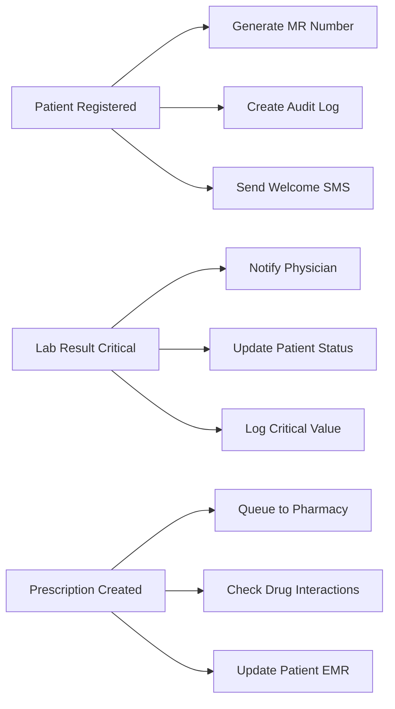
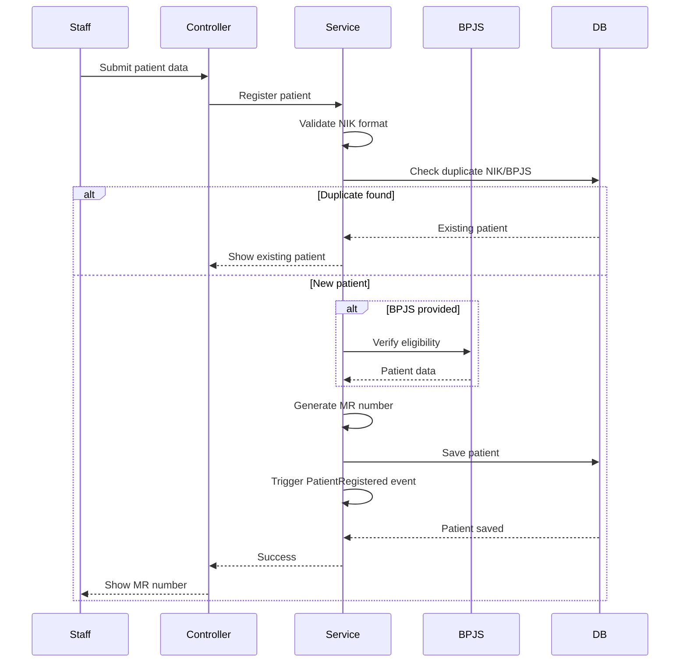
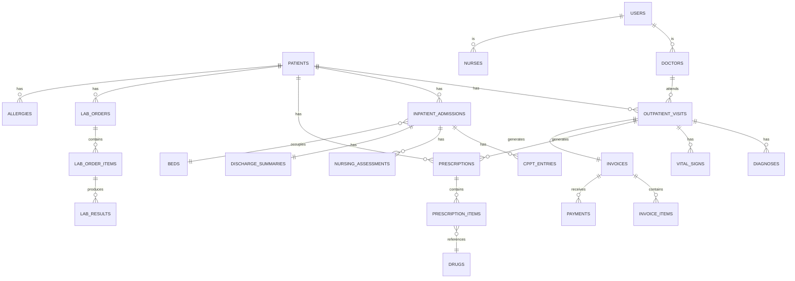

# Design Document: SIMRS Khanza Full System Refactoring

## Overview

This document describes the technical design for refactoring the existing Laravel-based Hospital Information Management System (SIMRS) to align with SIMRS Khanza functionality. The system will support comprehensive hospital operations including patient registration, clinical documentation, pharmacy, laboratory, radiology, billing, and external integrations with BPJS and SATUSEHAT platforms.

### Design Goals

1. **Scalability**: Support 500+ concurrent users with sub-2-second response times
2. **Maintainability**: Clean architecture with clear separation of concerns
3. **Extensibility**: Modular design allowing easy addition of new features
4. **Reliability**: High availability with robust error handling and recovery
5. **Compliance**: Meet Indonesian healthcare regulations (Kemenkes, BPJS, Hospital Accreditation)
6. **Interoperability**: Seamless integration with external systems (BPJS VClaim, SATUSEHAT FHIR, HL7 devices)

### Technology Stack

- **Backend Framework**: Laravel 11 (PHP 8.3+)
- **Database**: MySQL 8.0+ with InnoDB engine
- **Cache**: Redis 7.0+ for session storage and data caching
- **Queue**: Redis-backed Laravel Queue for background jobs
- **Real-time**: Laravel Broadcasting with Pusher/Soketi for WebSocket
- **Frontend**: Blade templates, Livewire 3.x, Alpine.js 3.x, Tailwind CSS 3.x
- **Storage**: S3/MinIO for file uploads and DICOM images
- **Search**: Laravel Scout with database driver (upgradeable to Meilisearch)
- **Testing**: PHPUnit, Pest for property-based tests
- **Monitoring**: Laravel Telescope (dev), Sentry (production)
- **Documentation**: API documentation with Scribe

---

## Architecture

### Layered Architecture

The system follows a clean layered architecture pattern:

```
┌─────────────────────────────────────────────────────────┐
│                    Presentation Layer                   │
│  (Controllers, Livewire Components, Blade Views, API)   │
└────────────────────┬────────────────────────────────────┘
                     │
┌────────────────────┴────────────────────────────────────┐
│                    Application Layer                    │
│        (Services, Actions, DTOs, Form Requests)         │
└────────────────────┬────────────────────────────────────┘
                     │
┌────────────────────┴────────────────────────────────────┐
│                     Domain Layer                        │
│  (Models, Repositories, Events, Observers, Policies)    │
└────────────────────┬────────────────────────────────────┘
                     │
┌────────────────────┴────────────────────────────────────┐
│                 Infrastructure Layer                    │
│    (External APIs, File Storage, Queue, Cache, DB)      │
└─────────────────────────────────────────────────────────┘
```

#### Layer Responsibilities

**Presentation Layer**
- HTTP request/response handling
- Input validation via Form Requests
- Response formatting (HTML, JSON, PDF)
- Real-time UI updates with Livewire
- API endpoints for external integrations

**Application Layer**
- Business logic orchestration
- Transaction management
- Service coordination
- DTO transformation
- Authorization checks

**Domain Layer**
- Core business entities (Models)
- Business rules enforcement
- Domain events
- Repository contracts
- Model relationships and scopes

**Infrastructure Layer**
- Database access via Eloquent
- External API clients (BPJS, SATUSEHAT)
- File storage operations
- Queue job processing
- Cache operations
- Email/SMS notifications

### Module Organization

The application is organized into bounded contexts following Domain-Driven Design principles:

```
app/
├── Modules/
│   ├── Registration/          # Patient registration & queue
│   │   ├── Controllers/
│   │   ├── Services/
│   │   ├── Models/
│   │   ├── Repositories/
│   │   ├── Events/
│   │   ├── Livewire/
│   │   └── routes.php
│   ├── Outpatient/           # Ambulatory care
│   ├── Inpatient/            # Hospitalization
│   ├── Emergency/            # Emergency department
│   ├── OperatingRoom/        # Surgical procedures
│   ├── Pharmacy/             # Medication management
│   ├── Laboratory/           # Lab orders & results
│   ├── Radiology/            # Imaging studies
│   ├── Billing/              # Financial transactions
│   ├── MedicalRecord/        # Integrated EMR
│   ├── Integration/          # External integrations
│   │   ├── BPJS/
│   │   └── SatuSehat/
│   └── Reporting/            # Reports & analytics
├── Shared/                   # Shared utilities
│   ├── Services/
│   ├── Traits/
│   ├── Enums/
│   └── Helpers/
└── Core/                     # Core functionality
    ├── Auth/
    ├── Audit/
    └── Notification/
```

Each module is self-contained with its own:
- Controllers for HTTP handling
- Services for business logic
- Models for data entities
- Repositories for data access
- Livewire components for real-time UI
- Routes file for module-specific routes

### Event-Driven Architecture

The system uses Laravel Events for decoupled communication between modules:



**Key Events:**
- `PatientRegistered` - New patient created
- `QueueNumberCalled` - Queue advancement notification
- `VitalSignsRecorded` - New vital signs entered
- `LabResultFinalized` - Lab results ready
- `CriticalValueDetected` - Critical lab/vital signs
- `PrescriptionCreated` - New medication order
- `BedAssigned` - Patient admitted to bed
- `DischargeCompleted` - Patient discharged
- `BillingGenerated` - Invoice created
- `PaymentReceived` - Payment processed

---

## Components and Interfaces

### 1. Registration & Queue Module

**Purpose**: Handle patient registration, medical record number generation, and queue management across departments.

#### Key Components

**Controllers:**
- `PatientController` - CRUD operations for patient demographics
- `QueueController` - Queue number generation and management
- `QueueDisplayController` - Display screens for waiting areas

**Services:**
- `PatientRegistrationService` - Orchestrates patient registration workflow
- `MedicalRecordNumberService` - Generates unique MR numbers
- `QueueManagementService` - Queue operations and status tracking
- `DuplicatePatientCheckService` - NIK/BPJS duplicate detection

**Models:**
- `Patient` - Patient demographics and identifiers
- `Queue` - Queue entries for departments
- `QueueCounter` - Daily queue number sequences

**Livewire Components:**
- `PatientSearch` - Real-time patient search
- `QueueDisplay` - Live queue board for waiting areas
- `QueueCallButton` - Queue advancement interface

**API Endpoints:**
```php
// Patient Registration
POST   /api/v1/patients              // Create patient
GET    /api/v1/patients/{id}         // Get patient details
PUT    /api/v1/patients/{id}         // Update patient
GET    /api/v1/patients/search       // Search patients

// Queue Management
POST   /api/v1/queues                // Generate queue number
PUT    /api/v1/queues/{id}/call      // Call next queue
GET    /api/v1/queues/display/{dept} // Get queue display data
```

**Database Tables:**
- `patients` - Core patient demographics
- `queues` - Active queue entries
- `queue_counters` - Sequence tracking per department/date
- `patient_photos` - Patient photo storage references

#### Workflows

**Patient Registration Flow:**


### 2. BPJS Integration Module

**Purpose**: Interface with Indonesian national health insurance system for eligibility verification and claims submission.

#### Key Components

**Services:**
- `BpjsVClaimClient` - HTTP client for VClaim API
- `BpjsEligibilityService` - Patient eligibility verification
- `BpjsSepService` - SEP (eligibility letter) management
- `BpjsClaimService` - Claims submission and tracking

**Models:**
- `BpjsCard` - BPJS card information
- `Sep` - Eligibility letters
- `BpjsClaim` - Claim submissions
- `BpjsClaimVerification` - Claim verification results

**Jobs:**
- `SyncBpjsReferenceData` - Daily sync of BPJS reference data
- `SubmitBpjsClaim` - Queue claim submissions
- `FetchClaimStatus` - Poll claim verification status

**Configuration:**
```php
// config/bpjs.php
return [
    'base_url' => env('BPJS_BASE_URL'),
    'cons_id' => env('BPJS_CONS_ID'),
    'secret_key' => env('BPJS_SECRET_KEY'),
    'user_key' => env('BPJS_USER_KEY'),
    'timeout' => 10, // seconds
    'retry_times' => 3,
    'retry_delay' => 1000, // ms
];
```

**API Client Implementation:**
```php
class BpjsVClaimClient
{
    protected function generateSignature(): string
    {
        $consId = config('bpjs.cons_id');
        $secretKey = config('bpjs.secret_key');
        $timestamp = now()->timestamp;
        
        $data = $consId . "&" . $timestamp;
        $signature = hash_hmac('sha256', $data, $secretKey, true);
        
        return base64_encode($signature);
    }
    
    protected function request(string $method, string $endpoint, array $data = []): array
    {
        $timestamp = now()->timestamp;
        
        return Http::withHeaders([
            'X-cons-id' => config('bpjs.cons_id'),
            'X-timestamp' => $timestamp,
            'X-signature' => $this->generateSignature(),
            'user_key' => config('bpjs.user_key'),
        ])->retry(3, 1000)
          ->timeout(10)
          ->{$method}(config('bpjs.base_url') . $endpoint, $data)
          ->throw()
          ->json();
    }
}
```

### 3. Outpatient Module

**Purpose**: Manage ambulatory care including SOAP documentation, vital signs, and ICD coding.

#### Key Components

**Controllers:**
- `OutpatientVisitController` - Visit registration and management
- `SoapNoteController` - SOAP documentation
- `VitalSignsController` - Vital signs recording

**Services:**
- `OutpatientRegistrationService` - Visit creation workflow
- `SoapDocumentationService` - Clinical note management
- `IcdSearchService` - ICD-10/ICD-9-CM code search
- `VitalSignsValidationService` - Normal range checking

**Models:**
- `OutpatientVisit` (existing: `RawatJalan`)
- `SoapNote` - Clinical documentation
- `VitalSigns` - Vital signs measurements
- `Diagnosis` - ICD-10 diagnoses
- `Procedure` - ICD-9-CM procedures

**Database Tables:**
```sql
-- Extend rawat_jalans
ALTER TABLE rawat_jalans 
  ADD COLUMN soap_subjective TEXT,
  ADD COLUMN soap_objective TEXT,
  ADD COLUMN soap_assessment TEXT,
  ADD COLUMN soap_plan TEXT,
  ADD INDEX idx_tanggal_kunjungan (tanggal_kunjungan),
  ADD INDEX idx_status (status);

-- New tables
CREATE TABLE diagnoses (
    id BIGINT UNSIGNED PRIMARY KEY AUTO_INCREMENT,
    visit_id BIGINT UNSIGNED,
    visit_type ENUM('outpatient', 'inpatient', 'emergency'),
    icd10_code VARCHAR(10),
    icd10_description TEXT,
    is_primary BOOLEAN DEFAULT FALSE,
    created_at TIMESTAMP,
    INDEX idx_visit (visit_id, visit_type),
    INDEX idx_icd10_code (icd10_code)
);

CREATE TABLE procedures (
    id BIGINT UNSIGNED PRIMARY KEY AUTO_INCREMENT,
    visit_id BIGINT UNSIGNED,
    visit_type ENUM('outpatient', 'inpatient', 'emergency'),
    icd9cm_code VARCHAR(10),
    icd9cm_description TEXT,
    quantity INT DEFAULT 1,
    unit_price DECIMAL(15,2),
    total_price DECIMAL(15,2),
    created_at TIMESTAMP,
    INDEX idx_visit (visit_id, visit_type)
);

CREATE TABLE vital_signs (
    id BIGINT UNSIGNED PRIMARY KEY AUTO_INCREMENT,
    patient_id BIGINT UNSIGNED,
    visit_id BIGINT UNSIGNED,
    visit_type ENUM('outpatient', 'inpatient', 'emergency'),
    blood_pressure_systolic INT,
    blood_pressure_diastolic INT,
    temperature DECIMAL(4,1),
    pulse INT,
    respiratory_rate INT,
    oxygen_saturation DECIMAL(5,2),
    height DECIMAL(5,2),
    weight DECIMAL(5,2),
    bmi DECIMAL(5,2),
    recorded_at TIMESTAMP,
    recorded_by BIGINT UNSIGNED,
    INDEX idx_patient (patient_id),
    INDEX idx_visit (visit_id, visit_type),
    INDEX idx_recorded_at (recorded_at)
);
```

### 4. Laboratory Module

**Purpose**: Manage laboratory orders, specimen tracking, result entry, and reporting.

#### Key Components

**Controllers:**
- `LabOrderController` - Laboratory test ordering
- `LabResultController` - Result entry and validation
- `LabReportController` - Result reporting and viewing

**Services:**
- `LabOrderService` - Order creation and management
- `LabResultService` - Result entry and validation
- `LabNormalRangeService` - Age/gender-based normal ranges
- `CriticalValueAlertService` - Critical value notification
- `LabReportGeneratorService` - PDF report generation

**Models:**
- `LabOrder` - Laboratory test requests
- `LabOrderItem` - Individual tests in an order
- `LabResult` - Test results
- `LabTestCatalog` - Available tests
- `LabTestTemplate` - Predefined test panels
- `LabSpecimen` - Specimen tracking

**Database Tables:**
```sql
CREATE TABLE lab_orders (
    id BIGINT UNSIGNED PRIMARY KEY AUTO_INCREMENT,
    order_number VARCHAR(50) UNIQUE,
    patient_id BIGINT UNSIGNED,
    visit_id BIGINT UNSIGNED,
    visit_type ENUM('outpatient', 'inpatient', 'emergency'),
    ordering_physician_id BIGINT UNSIGNED,
    clinical_indication TEXT,
    status ENUM('pending', 'collected', 'processing', 'completed', 'cancelled') DEFAULT 'pending',
    ordered_at TIMESTAMP,
    collected_at TIMESTAMP NULL,
    completed_at TIMESTAMP NULL,
    INDEX idx_patient (patient_id),
    INDEX idx_status (status),
    INDEX idx_ordered_at (ordered_at)
);

CREATE TABLE lab_order_items (
    id BIGINT UNSIGNED PRIMARY KEY AUTO_INCREMENT,
    lab_order_id BIGINT UNSIGNED,
    test_code VARCHAR(20),
    test_name VARCHAR(255),
    specimen_type VARCHAR(50),
    urgency ENUM('routine', 'urgent', 'stat') DEFAULT 'routine',
    INDEX idx_order (lab_order_id)
);

CREATE TABLE lab_results (
    id BIGINT UNSIGNED PRIMARY KEY AUTO_INCREMENT,
    lab_order_item_id BIGINT UNSIGNED,
    result_value VARCHAR(500),
    result_type ENUM('numeric', 'text', 'dropdown'),
    unit VARCHAR(50),
    normal_range VARCHAR(100),
    flag ENUM('normal', 'high', 'low', 'critical_high', 'critical_low', 'abnormal') DEFAULT 'normal',
    result_notes TEXT,
    verified_by BIGINT UNSIGNED,
    verified_at TIMESTAMP,
    INDEX idx_order_item (lab_order_item_id),
    INDEX idx_flag (flag)
);

CREATE TABLE lab_test_catalog (
    id BIGINT UNSIGNED PRIMARY KEY AUTO_INCREMENT,
    test_code VARCHAR(20) UNIQUE,
    test_name VARCHAR(255),
    test_category VARCHAR(100),
    specimen_type VARCHAR(50),
    result_type ENUM('numeric', 'text', 'dropdown'),
    unit VARCHAR(50),
    normal_range_male VARCHAR(100),
    normal_range_female VARCHAR(100),
    critical_low DECIMAL(10,2),
    critical_high DECIMAL(10,2),
    turnaround_time_hours INT,
    price DECIMAL(15,2),
    is_active BOOLEAN DEFAULT TRUE,
    INDEX idx_category (test_category)
);

CREATE TABLE lab_test_templates (
    id BIGINT UNSIGNED PRIMARY KEY AUTO_INCREMENT,
    template_name VARCHAR(255),
    clinical_indication VARCHAR(255),
    is_active BOOLEAN DEFAULT TRUE
);

CREATE TABLE lab_test_template_items (
    id BIGINT UNSIGNED PRIMARY KEY AUTO_INCREMENT,
    template_id BIGINT UNSIGNED,
    test_code VARCHAR(20),
    INDEX idx_template (template_id)
);
```

**HL7 Integration:**
```php
class Hl7ResultParser
{
    public function parse(string $hl7Message): array
    {
        $segments = explode("\r", $hl7Message);
        $results = [];
        
        foreach ($segments as $segment) {
            $fields = explode('|', $segment);
            
            if ($fields[0] === 'OBX') {
                $results[] = [
                    'test_code' => $fields[3] ?? null,
                    'result_value' => $fields[5] ?? null,
                    'unit' => $fields[6] ?? null,
                    'normal_range' => $fields[7] ?? null,
                    'flag' => $this->mapAbnormalFlag($fields[8] ?? ''),
                    'result_status' => $fields[11] ?? null,
                ];
            }
        }
        
        return $results;
    }
    
    protected function mapAbnormalFlag(string $flag): string
    {
        return match($flag) {
            'H', 'HH' => 'high',
            'L', 'LL' => 'low',
            'A' => 'abnormal',
            default => 'normal',
        };
    }
}
```

### 5. Pharmacy Module

**Purpose**: Manage medication inventory, prescription processing, drug interaction checking, and dispensing.

#### Key Components

**Controllers:**
- `PrescriptionController` - Prescription creation and management
- `PharmacyDispensingController` - Medication dispensing
- `DrugInventoryController` - Stock management
- `DrugCatalogController` - Formulary management

**Services:**
- `PrescriptionService` - Prescription workflow orchestration
- `DrugInteractionService` - Drug interaction checking
- `PharmacyDispensingService` - Dispensing workflow
- `DrugInventoryService` - Stock tracking with FIFO
- `DrugFormularyService` - BPJS formulary management

**Models:**
- `Prescription` (existing: `Resep`)
- `PrescriptionItem` (existing: `ResepDetail`)
- `Drug` (existing: `Obat`)
- `DrugBatch` - Batch tracking with expiry
- `DrugInteraction` - Drug interaction rules
- `DrugFormulary` - BPJS coverage status

**Database Tables:**
```sql
-- Extend obats table
ALTER TABLE obats
  ADD COLUMN is_bpjs_formulary BOOLEAN DEFAULT FALSE,
  ADD COLUMN is_high_alert BOOLEAN DEFAULT FALSE,
  ADD COLUMN therapeutic_class VARCHAR(100),
  ADD COLUMN requires_approval BOOLEAN DEFAULT FALSE,
  ADD INDEX idx_nama_obat (nama_obat),
  ADD INDEX idx_formulary (is_bpjs_formulary);

-- New tables
CREATE TABLE drug_batches (
    id BIGINT UNSIGNED PRIMARY KEY AUTO_INCREMENT,
    drug_id BIGINT UNSIGNED,
    batch_number VARCHAR(50),
    expiry_date DATE,
    quantity INT,
    purchase_price DECIMAL(15,2),
    supplier_id BIGINT UNSIGNED,
    received_date DATE,
    storage_location VARCHAR(100),
    INDEX idx_drug (drug_id),
    INDEX idx_expiry (expiry_date),
    INDEX idx_location (storage_location)
);

CREATE TABLE drug_interactions (
    id BIGINT UNSIGNED PRIMARY KEY AUTO_INCREMENT,
    drug1_id BIGINT UNSIGNED,
    drug2_id BIGINT UNSIGNED,
    severity ENUM('minor', 'moderate', 'major', 'contraindicated'),
    description TEXT,
    clinical_effect TEXT,
    management TEXT,
    INDEX idx_drugs (drug1_id, drug2_id)
);

CREATE TABLE prescription_verifications (
    id BIGINT UNSIGNED PRIMARY KEY AUTO_INCREMENT,
    prescription_id BIGINT UNSIGNED,
    verified_by BIGINT UNSIGNED,
    verified_at TIMESTAMP,
    interaction_warnings TEXT,
    pharmacist_notes TEXT,
    counseling_provided BOOLEAN DEFAULT FALSE,
    INDEX idx_prescription (prescription_id)
);

CREATE TABLE drug_stock_movements (
    id BIGINT UNSIGNED PRIMARY KEY AUTO_INCREMENT,
    drug_id BIGINT UNSIGNED,
    batch_id BIGINT UNSIGNED,
    movement_type ENUM('purchase', 'dispense', 'transfer', 'adjustment', 'return'),
    quantity INT,
    reference_type VARCHAR(50), -- prescription, transfer, etc
    reference_id BIGINT UNSIGNED,
    created_at TIMESTAMP,
    created_by BIGINT UNSIGNED,
    INDEX idx_drug (drug_id),
    INDEX idx_created_at (created_at)
);
```

**Drug Interaction Checking:**
```php
class DrugInteractionService
{
    public function checkInteractions(array $drugIds, int $patientId): array
    {
        $interactions = [];
        
        // Get active prescriptions
        $activeDrugs = Prescription::where('patient_id', $patientId)
            ->where('status', 'active')
            ->with('items.drug')
            ->get()
            ->pluck('items.*.drug.id')
            ->flatten()
            ->unique()
            ->toArray();
        
        // Combine with new drugs
        $allDrugs = array_merge($activeDrugs, $drugIds);
        
        // Check all combinations
        for ($i = 0; $i < count($allDrugs); $i++) {
            for ($j = $i + 1; $j < count($allDrugs); $j++) {
                $interaction = DrugInteraction::where(function($q) use ($allDrugs, $i, $j) {
                    $q->where('drug1_id', $allDrugs[$i])
                      ->where('drug2_id', $allDrugs[$j]);
                })->orWhere(function($q) use ($allDrugs, $i, $j) {
                    $q->where('drug1_id', $allDrugs[$j])
                      ->where('drug2_id', $allDrugs[$i]);
                })->first();
                
                if ($interaction) {
                    $interactions[] = $interaction;
                }
            }
        }
        
        return collect($interactions)->sortByDesc('severity')->values()->all();
    }
}
```

### 6. Inpatient Module

**Purpose**: Manage hospitalization including admissions, bed management, CPPT documentation, and discharge.

#### Key Components

**Controllers:**
- `InpatientAdmissionController` - Patient admission workflow
- `BedManagementController` - Bed assignment and tracking
- `CpptController` - Integrated progress notes
- `InpatientDischargeController` - Discharge documentation

**Services:**
- `InpatientAdmissionService` - Admission orchestration
- `BedAllocationService` - Bed availability and assignment
- `CpptDocumentationService` - Progress note management
- `FluidBalanceService` - Intake/output calculation
- `DischargeService` - Discharge workflow

**Models:**
- `InpatientAdmission` (existing: `RawatInap`)
- `Bed` (existing: `Bed`)
- `Room` (existing: `Kamar`)
- `Cppt` - Integrated progress notes
- `FluidBalance` - Fluid intake/output tracking
- `NursingAssessment` - Initial nursing assessment
- `DischargeSummary` - Discharge documentation

**Database Tables:**
```sql
-- Extend beds table
ALTER TABLE beds
  ADD COLUMN bed_type ENUM('regular', 'icu', 'nicu', 'isolation') DEFAULT 'regular',
  ADD COLUMN equipment_available TEXT,
  ADD INDEX idx_status (status);

-- New tables
CREATE TABLE cppt_entries (
    id BIGINT UNSIGNED PRIMARY KEY AUTO_INCREMENT,
    admission_id BIGINT UNSIGNED,
    entry_type ENUM('physician', 'nurse', 'nutritionist', 'pharmacist', 'therapist'),
    entry_date DATE,
    entry_time TIME,
    subjective TEXT,
    objective TEXT,
    assessment TEXT,
    plan TEXT,
    provider_id BIGINT UNSIGNED,
    provider_type VARCHAR(50),
    shift ENUM('morning', 'afternoon', 'night') NULL,
    created_at TIMESTAMP,
    INDEX idx_admission (admission_id),
    INDEX idx_entry_date (entry_date)
);

CREATE TABLE fluid_balance_records (
    id BIGINT UNSIGNED PRIMARY KEY AUTO_INCREMENT,
    admission_id BIGINT UNSIGNED,
    record_date DATE,
    record_shift ENUM('morning', 'afternoon', 'night'),
    intake_oral DECIMAL(10,2) DEFAULT 0,
    intake_iv DECIMAL(10,2) DEFAULT 0,
    intake_blood DECIMAL(10,2) DEFAULT 0,
    intake_other DECIMAL(10,2) DEFAULT 0,
    output_urine DECIMAL(10,2) DEFAULT 0,
    output_drain DECIMAL(10,2) DEFAULT 0,
    output_vomit DECIMAL(10,2) DEFAULT 0,
    output_other DECIMAL(10,2) DEFAULT 0,
    balance DECIMAL(10,2) GENERATED ALWAYS AS (
        (intake_oral + intake_iv + intake_blood + intake_other) - 
        (output_urine + output_drain + output_vomit + output_other)
    ) STORED,
    recorded_by BIGINT UNSIGNED,
    INDEX idx_admission (admission_id),
    INDEX idx_date (record_date)
);

CREATE TABLE nursing_assessments (
    id BIGINT UNSIGNED PRIMARY KEY AUTO_INCREMENT,
    admission_id BIGINT UNSIGNED,
    assessment_type ENUM('initial', 'shift', 'discharge'),
    consciousness_level VARCHAR(50),
    pain_score INT,
    fall_risk_score INT,
    pressure_ulcer_risk_score INT,
    suicide_risk BOOLEAN DEFAULT FALSE,
    assessment_notes TEXT,
    assessed_by BIGINT UNSIGNED,
    assessed_at TIMESTAMP,
    INDEX idx_admission (admission_id)
);

CREATE TABLE discharge_summaries (
    id BIGINT UNSIGNED PRIMARY KEY AUTO_INCREMENT,
    admission_id BIGINT UNSIGNED,
    admission_diagnosis TEXT,
    hospital_course TEXT,
    discharge_diagnosis TEXT,
    procedures_performed TEXT,
    discharge_condition VARCHAR(100),
    discharge_disposition ENUM('home', 'home_with_care', 'snf', 'transfer', 'deceased'),
    discharge_medications TEXT,
    discharge_instructions TEXT,
    follow_up_plan TEXT,
    physician_id BIGINT UNSIGNED,
    discharged_at TIMESTAMP,
    INDEX idx_admission (admission_id)
);

CREATE TABLE bed_transfers (
    id BIGINT UNSIGNED PRIMARY KEY AUTO_INCREMENT,
    admission_id BIGINT UNSIGNED,
    from_bed_id BIGINT UNSIGNED,
    to_bed_id BIGINT UNSIGNED,
    transfer_reason TEXT,
    transferred_at TIMESTAMP,
    transferred_by BIGINT UNSIGNED,
    INDEX idx_admission (admission_id)
);
```

### 7. Billing Module

**Purpose**: Automated charge calculation, invoice generation, payment processing, and BPJS claim separation.

#### Key Components

**Controllers:**
- `BillingController` - Invoice generation and management
- `PaymentController` - Payment processing
- `ChargeController` - Charge item management

**Services:**
- `BillingCalculationService` - Aggregate charges from all modules
- `PricingService` - Insurance class-based pricing
- `PaymentProcessingService` - Multi-payment method handling
- `BpjsClaimSeparationService` - Separate billable/non-billable items

**Models:**
- `Invoice` (existing: `Billing`)
- `InvoiceItem` - Itemized charges
- `Payment` - Payment transactions
- `Tariff` - Service pricing by insurance class
- `PaymentMethod` - Payment method configuration

**Database Tables:**
```sql
-- Extend billing table
ALTER TABLE billings
  ADD COLUMN invoice_number VARCHAR(50) UNIQUE,
  ADD COLUMN insurance_class ENUM('general', 'bpjs_1', 'bpjs_2', 'bpjs_3', 'private') DEFAULT 'general',
  ADD COLUMN subtotal DECIMAL(15,2),
  ADD COLUMN discount_amount DECIMAL(15,2) DEFAULT 0,
  ADD COLUMN tax_amount DECIMAL(15,2) DEFAULT 0,
  ADD COLUMN total_amount DECIMAL(15,2),
  ADD COLUMN paid_amount DECIMAL(15,2) DEFAULT 0,
  ADD COLUMN status ENUM('draft', 'finalized', 'partial', 'paid', 'cancelled') DEFAULT 'draft',
  ADD INDEX idx_status (status),
  ADD INDEX idx_invoice_number (invoice_number);

-- New tables
CREATE TABLE invoice_items (
    id BIGINT UNSIGNED PRIMARY KEY AUTO_INCREMENT,
    invoice_id BIGINT UNSIGNED,
    item_category ENUM('consultation', 'procedure', 'medication', 'laboratory', 'radiology', 'room', 'nursing', 'other'),
    item_code VARCHAR(50),
    item_description TEXT,
    quantity INT DEFAULT 1,
    unit_price DECIMAL(15,2),
    total_price DECIMAL(15,2),
    is_bpjs_covered BOOLEAN DEFAULT FALSE,
    source_type VARCHAR(50), -- prescription, lab_order, etc
    source_id BIGINT UNSIGNED,
    INDEX idx_invoice (invoice_id),
    INDEX idx_category (item_category)
);

CREATE TABLE payments (
    id BIGINT UNSIGNED PRIMARY KEY AUTO_INCREMENT,
    payment_number VARCHAR(50) UNIQUE,
    invoice_id BIGINT UNSIGNED,
    payment_method ENUM('cash', 'debit', 'credit', 'transfer', 'mixed'),
    amount DECIMAL(15,2),
    cash_amount DECIMAL(15,2) DEFAULT 0,
    card_amount DECIMAL(15,2) DEFAULT 0,
    transfer_amount DECIMAL(15,2) DEFAULT 0,
    payment_notes TEXT,
    received_by BIGINT UNSIGNED,
    paid_at TIMESTAMP,
    cancelled_at TIMESTAMP NULL,
    cancellation_reason TEXT NULL,
    INDEX idx_invoice (invoice_id),
    INDEX idx_paid_at (paid_at)
);

CREATE TABLE tariffs (
    id BIGINT UNSIGNED PRIMARY KEY AUTO_INCREMENT,
    item_code VARCHAR(50),
    item_category VARCHAR(50),
    item_name VARCHAR(255),
    insurance_class ENUM('general', 'bpjs_1', 'bpjs_2', 'bpjs_3', 'private'),
    price DECIMAL(15,2),
    is_bpjs_covered BOOLEAN DEFAULT FALSE,
    effective_date DATE,
    INDEX idx_item (item_code, insurance_class)
);
```

**Billing Calculation Logic:**
```php
class BillingCalculationService
{
    public function calculateInvoice(int $visitId, string $visitType, string $insuranceClass): array
    {
        $items = [];
        
        // Consultation charges
        $items = array_merge($items, $this->getConsultationCharges($visitId, $visitType, $insuranceClass));
        
        // Procedure charges
        $items = array_merge($items, $this->getProcedureCharges($visitId, $visitType, $insuranceClass));
        
        // Medication charges
        $items = array_merge($items, $this->getMedicationCharges($visitId, $visitType, $insuranceClass));
        
        // Laboratory charges
        $items = array_merge($items, $this->getLaboratoryCharges($visitId, $visitType, $insuranceClass));
        
        // Radiology charges
        $items = array_merge($items, $this->getRadiologyCharges($visitId, $visitType, $insuranceClass));
        
        // Room charges (inpatient only)
        if ($visitType === 'inpatient') {
            $items = array_merge($items, $this->getRoomCharges($visitId, $insuranceClass));
        }
        
        // Calculate totals
        $subtotal = collect($items)->sum('total_price');
        $discount = $this->calculateDiscount($subtotal, $insuranceClass);
        $tax = $this->calculateTax($subtotal - $discount);
        $total = $subtotal - $discount + $tax;
        
        return [
            'items' => $items,
            'subtotal' => $subtotal,
            'discount' => $discount,
            'tax' => $tax,
            'total' => $total,
        ];
    }
    
    protected function getRoomCharges(int $admissionId, string $insuranceClass): array
    {
        $admission = InpatientAdmission::with('bed.room')->find($admissionId);
        $days = $admission->tanggal_keluar 
            ? $admission->tanggal_masuk->diffInDays($admission->tanggal_keluar)
            : $admission->tanggal_masuk->diffInDays(now());
        
        $tariff = Tariff::where('item_code', $admission->bed->room->room_type)
            ->where('insurance_class', $insuranceClass)
            ->where('effective_date', '<=', now())
            ->orderBy('effective_date', 'desc')
            ->first();
        
        return [[
            'category' => 'room',
            'description' => "Room charge ({$admission->bed->room->name})",
            'quantity' => $days,
            'unit_price' => $tariff->price,
            'total_price' => $days * $tariff->price,
            'is_bpjs_covered' => $tariff->is_bpjs_covered,
        ]];
    }
}
```

### 8. Medical Record Module

**Purpose**: Integrated electronic medical record providing comprehensive patient history across all encounters.

#### Key Components

**Controllers:**
- `MedicalRecordController` - EMR viewing and searching
- `DocumentUploadController` - Scanned document management
- `ClinicalSummaryController` - Summary generation for referrals

**Services:**
- `MedicalRecordAggregationService` - Aggregate data from all modules
- `DocumentIndexingService` - Document categorization and OCR
- `ClinicalSummaryGeneratorService` - Generate continuity of care documents
- `MedicalRecordAccessLogService` - Audit trail for record access

**Models:**
- `MedicalRecord` - Aggregated patient record
- `UploadedDocument` - Scanned documents
- `ActiveProblem` - Current patient problems
- `Allergy` - Patient allergies
- `MedicalRecordAccess` - Access audit trail

**Database Tables:**
```sql
CREATE TABLE active_problems (
    id BIGINT UNSIGNED PRIMARY KEY AUTO_INCREMENT,
    patient_id BIGINT UNSIGNED,
    problem_description TEXT,
    icd10_code VARCHAR(10),
    onset_date DATE,
    resolved_date DATE NULL,
    status ENUM('active', 'resolved', 'chronic') DEFAULT 'active',
    entered_by BIGINT UNSIGNED,
    created_at TIMESTAMP,
    INDEX idx_patient (patient_id),
    INDEX idx_status (status)
);

CREATE TABLE allergies (
    id BIGINT UNSIGNED PRIMARY KEY AUTO_INCREMENT,
    patient_id BIGINT UNSIGNED,
    allergen_type ENUM('drug', 'food', 'environmental', 'other'),
    allergen_name VARCHAR(255),
    reaction TEXT,
    severity ENUM('mild', 'moderate', 'severe', 'life_threatening'),
    onset_date DATE NULL,
    entered_by BIGINT UNSIGNED,
    verified_by BIGINT UNSIGNED NULL,
    created_at TIMESTAMP,
    INDEX idx_patient (patient_id),
    INDEX idx_allergen_type (allergen_type)
);

CREATE TABLE uploaded_documents (
    id BIGINT UNSIGNED PRIMARY KEY AUTO_INCREMENT,
    patient_id BIGINT UNSIGNED,
    document_type ENUM('lab', 'radiology', 'referral', 'consent', 'insurance', 'other'),
    document_name VARCHAR(255),
    file_path VARCHAR(500),
    file_size INT,
    mime_type VARCHAR(100),
    upload_date DATE,
    uploaded_by BIGINT UNSIGNED,
    INDEX idx_patient (patient_id),
    INDEX idx_document_type (document_type)
);

CREATE TABLE medical_record_access_logs (
    id BIGINT UNSIGNED PRIMARY KEY AUTO_INCREMENT,
    patient_id BIGINT UNSIGNED,
    accessed_by BIGINT UNSIGNED,
    access_type ENUM('view', 'edit', 'print', 'export'),
    accessed_section VARCHAR(100),
    ip_address VARCHAR(45),
    user_agent TEXT,
    accessed_at TIMESTAMP,
    INDEX idx_patient (patient_id),
    INDEX idx_accessed_by (accessed_by),
    INDEX idx_accessed_at (accessed_at)
);
```

### 9. SATUSEHAT Integration Module

**Purpose**: Submit patient encounter data to Ministry of Health platform in FHIR format.

#### Key Components

**Services:**
- `SatuSehatFhirClient` - HTTP client for SATUSEHAT API
- `FhirMapper` - Map EMR data to FHIR resources
- `SatuSehatSubmissionService` - Queue and submit encounters
- `SatuSehatAuthService` - OAuth2 authentication

**Jobs:**
- `SubmitEncounterToSatuSehat` - Background encounter submission
- `RetryFailedSubmissions` - Exponential backoff retry

**Models:**
- `SatuSehatSubmission` - Submission tracking
- `SatuSehatError` - Error logging for troubleshooting

**FHIR Mapping:**
```php
class FhirMapper
{
    public function mapPatient(Patient $patient): array
    {
        return [
            'resourceType' => 'Patient',
            'identifier' => [
                [
                    'system' => 'https://fhir.kemkes.go.id/id/nik',
                    'value' => $patient->nik,
                ],
                [
                    'system' => 'https://fhir.kemkes.go.id/id/ihs-number',
                    'value' => $patient->no_rm,
                ],
            ],
            'active' => true,
            'name' => [
                [
                    'use' => 'official',
                    'text' => $patient->nama_lengkap,
                ],
            ],
            'gender' => $patient->jenis_kelamin === 'L' ? 'male' : 'female',
            'birthDate' => $patient->tanggal_lahir->format('Y-m-d'),
            'address' => [
                [
                    'use' => 'home',
                    'line' => [$patient->alamat],
                    'city' => $patient->kota,
                    'state' => $patient->provinsi,
                    'postalCode' => $patient->kode_pos,
                    'country' => 'ID',
                ],
            ],
            'telecom' => [
                [
                    'system' => 'phone',
                    'value' => $patient->no_telepon,
                    'use' => 'mobile',
                ],
            ],
        ];
    }
    
    public function mapEncounter(OutpatientVisit $visit): array
    {
        return [
            'resourceType' => 'Encounter',
            'status' => $this->mapEncounterStatus($visit->status),
            'class' => [
                'system' => 'http://terminology.hl7.org/CodeSystem/v3-ActCode',
                'code' => 'AMB',
                'display' => 'ambulatory',
            ],
            'subject' => [
                'reference' => 'Patient/' . $visit->patient_id,
            ],
            'participant' => [
                [
                    'type' => [
                        [
                            'coding' => [
                                [
                                    'system' => 'http://terminology.hl7.org/CodeSystem/v3-ParticipationType',
                                    'code' => 'ATND',
                                    'display' => 'attender',
                                ],
                            ],
                        ],
                    ],
                    'individual' => [
                        'reference' => 'Practitioner/' . $visit->dokter_id,
                    ],
                ],
            ],
            'period' => [
                'start' => $visit->tanggal_kunjungan->toIso8601String(),
            ],
            'diagnosis' => $visit->diagnoses->map(function($diagnosis) {
                return [
                    'condition' => [
                        'reference' => 'Condition/' . $diagnosis->id,
                    ],
                    'use' => [
                        'coding' => [
                            [
                                'system' => 'http://terminology.hl7.org/CodeSystem/diagnosis-role',
                                'code' => $diagnosis->is_primary ? 'AD' : 'SD',
                                'display' => $diagnosis->is_primary ? 'Admission diagnosis' : 'Secondary diagnosis',
                            ],
                        ],
                    ],
                ];
            })->toArray(),
        ];
    }
}
```

---

## Data Models

### Entity Relationship Overview



### Core Model Relationships

**Patient Model:**
```php
class Patient extends Model
{
    use HasFactory, HasUuid, Auditable, Searchable;
    
    protected $fillable = [
        'no_rm', 'nik', 'no_bpjs', 'nama_lengkap', 'jenis_kelamin',
        'tempat_lahir', 'tanggal_lahir', 'golongan_darah', 'alamat',
        'rt', 'rw', 'kelurahan', 'kecamatan', 'kota', 'provinsi',
        'kode_pos', 'no_telepon', 'agama', 'status_perkawinan',
        'pekerjaan', 'pendidikan', 'nama_keluarga', 'hubungan_keluarga',
        'no_telepon_keluarga', 'foto',
    ];
    
    protected $casts = [
        'tanggal_lahir' => 'date',
    ];
    
    // Relationships
    public function outpatientVisits() { return $this->hasMany(OutpatientVisit::class); }
    public function inpatientAdmissions() { return $this->hasMany(InpatientAdmission::class); }
    public function prescriptions() { return $this->hasMany(Prescription::class); }
    public function labOrders() { return $this->hasMany(LabOrder::class); }
    public function radiologyOrders() { return $this->hasMany(RadiologyOrder::class); }
    public function invoices() { return $this->hasMany(Invoice::class); }
    public function allergies() { return $this->hasMany(Allergy::class); }
    public function activeProblems() { return $this->hasMany(ActiveProblem::class)->where('status', 'active'); }
    public function bpjsCard() { return $this->hasOne(BpjsCard::class); }
    
    // Scopes
    public function scopeSearch($query, $term) {
        return $query->where('no_rm', 'like', "%{$term}%")
            ->orWhere('nik', 'like', "%{$term}%")
            ->orWhere('no_bpjs', 'like', "%{$term}%")
            ->orWhere('nama_lengkap', 'like', "%{$term}%");
    }
    
    // Accessors
    public function getAgeAttribute() {
        return $this->tanggal_lahir->age;
    }
    
    public function getAgeGroupAttribute() {
        $age = $this->age;
        if ($age < 1) return 'neonate';
        if ($age < 13) return 'pediatric';
        if ($age < 18) return 'adolescent';
        if ($age < 65) return 'adult';
        return 'geriatric';
    }
}
```

**OutpatientVisit Model:**
```php
class OutpatientVisit extends Model
{
    use HasFactory, HasUuid, Auditable;
    
    protected $table = 'rawat_jalans';
    
    protected $fillable = [
        'no_registrasi', 'pasien_id', 'poliklinik_id', 'dokter_id',
        'tanggal_kunjungan', 'jam_kunjungan', 'jenis_kunjungan',
        'jenis_penjamin', 'no_antrian', 'keluhan', 'anamnesis',
        'soap_subjective', 'soap_objective', 'soap_assessment', 'soap_plan',
        'pemeriksaan_fisik', 'diagnosis', 'terapi', 'catatan', 'status',
    ];
    
    protected $casts = [
        'tanggal_kunjungan' => 'date',
    ];
    
    // Relationships
    public function patient() { return $this->belongsTo(Patient::class, 'pasien_id'); }
    public function clinic() { return $this->belongsTo(Poliklinik::class, 'poliklinik_id'); }
    public function doctor() { return $this->belongsTo(Dokter::class, 'dokter_id'); }
    public function vitalSigns() { return $this->morphMany(VitalSigns::class, 'visit'); }
    public function diagnoses() { return $this->morphMany(Diagnosis::class, 'visit'); }
    public function procedures() { return $this->morphMany(Procedure::class, 'visit'); }
    public function prescriptions() { return $this->morphMany(Prescription::class, 'visit'); }
    public function labOrders() { return $this->morphMany(LabOrder::class, 'visit'); }
    public function radiologyOrders() { return $this->morphMany(RadiologyOrder::class, 'visit'); }
    public function invoice() { return $this->morphOne(Invoice::class, 'billable'); }
    
    // Scopes
    public function scopeToday($query) {
        return $query->whereDate('tanggal_kunjungan', today());
    }
    
    public function scopeByStatus($query, $status) {
        return $query->where('status', $status);
    }
    
    // Events
    protected static function booted() {
        static::created(function ($visit) {
            event(new OutpatientVisitCreated($visit));
        });
        
        static::updated(function ($visit) {
            if ($visit->isDirty('status') && $visit->status === 'Selesai') {
                event(new OutpatientVisitCompleted($visit));
            }
        });
    }
}
```

### Model Traits

**Auditable Trait:**
```php
trait Auditable
{
    protected static function bootAuditable()
    {
        static::creating(function ($model) {
            if (auth()->check()) {
                $model->created_by = auth()->id();
            }
        });
        
        static::updating(function ($model) {
            if (auth()->check()) {
                $model->updated_by = auth()->id();
            }
        });
        
        static::created(function ($model) {
            AuditLog::create([
                'auditable_type' => get_class($model),
                'auditable_id' => $model->id,
                'action' => 'created',
                'old_values' => null,
                'new_values' => $model->getAttributes(),
                'user_id' => auth()->id(),
                'ip_address' => request()->ip(),
                'user_agent' => request()->userAgent(),
            ]);
        });
        
        static::updated(function ($model) {
            AuditLog::create([
                'auditable_type' => get_class($model),
                'auditable_id' => $model->id,
                'action' => 'updated',
                'old_values' => $model->getOriginal(),
                'new_values' => $model->getChanges(),
                'user_id' => auth()->id(),
                'ip_address' => request()->ip(),
                'user_agent' => request()->userAgent(),
            ]);
        });
    }
}
```

**HasUuid Trait:**
```php
trait HasUuid
{
    protected static function bootHasUuid()
    {
        static::creating(function ($model) {
            if (empty($model->uuid)) {
                $model->uuid = (string) Str::uuid();
            }
        });
    }
    
    public function getRouteKeyName()
    {
        return 'uuid';
    }
}
```

---

## Error Handling

### Exception Hierarchy

```
Exception
├── HttpException
│   ├── ValidationException (422)
│   ├── AuthenticationException (401)
│   ├── AuthorizationException (403)
│   └── NotFoundHttpException (404)
├── BusinessException (Custom)
│   ├── DuplicatePatientException
│   ├── BedUnavailableException
│   ├── InsufficientStockException
│   ├── DrugInteractionException
│   └── CriticalValueException
└── IntegrationException (Custom)
    ├── BpjsConnectionException
    ├── SatuSehatSubmissionException
    └── Hl7ParseException
```

### Global Exception Handler

```php
class Handler extends ExceptionHandler
{
    public function register()
    {
        $this->reportable(function (BusinessException $e) {
            Log::error('Business rule violation', [
                'exception' => get_class($e),
                'message' => $e->getMessage(),
                'user_id' => auth()->id(),
                'context' => $e->getContext(),
            ]);
        });
        
        $this->reportable(function (IntegrationException $e) {
            Log::critical('Integration failure', [
                'exception' => get_class($e),
                'message' => $e->getMessage(),
                'integration' => $e->getIntegration(),
                'request' => $e->getRequest(),
                'response' => $e->getResponse(),
            ]);
            
            // Send alert to ops team
            Notification::route('slack', config('logging.slack_webhook'))
                ->notify(new IntegrationFailureNotification($e));
        });
        
        $this->renderable(function (DuplicatePatientException $e, $request) {
            if ($request->expectsJson()) {
                return response()->json([
                    'message' => $e->getMessage(),
                    'existing_patient' => $e->getExistingPatient(),
                ], 409);
            }
            
            return back()->with('error', $e->getMessage())
                ->with('existing_patient', $e->getExistingPatient());
        });
    }
}
```

### Service Error Handling Pattern

```php
class BpjsEligibilityService
{
    public function verifyEligibility(string $bpjsNumber, string $serviceDate): array
    {
        try {
            $response = $this->client->request('GET', '/Peserta/' . $bpjsNumber, [
                'tglSEP' => $serviceDate,
            ]);
            
            if ($response['metaData']['code'] !== '200') {
                throw new BpjsException(
                    $response['metaData']['message'],
                    $response['metaData']['code']
                );
            }
            
            return $response['response'];
            
        } catch (ConnectionException $e) {
            Log::error('BPJS connection failed', [
                'bpjs_number' => $bpjsNumber,
                'error' => $e->getMessage(),
            ]);
            
            throw new BpjsConnectionException(
                'Unable to connect to BPJS VClaim. Please try again later.',
                previous: $e
            );
            
        } catch (RequestException $e) {
            Log::error('BPJS request failed', [
                'bpjs_number' => $bpjsNumber,
                'status' => $e->response->status(),
                'body' => $e->response->body(),
            ]);
            
            throw new BpjsException(
                'BPJS verification failed: ' . $e->response->json()['message'] ?? 'Unknown error',
                previous: $e
            );
        }
    }
}
```

### User-Friendly Error Messages

```php
// resources/lang/id/errors.php
return [
    'duplicate_patient' => 'Pasien dengan NIK/BPJS ini sudah terdaftar.',
    'bed_unavailable' => 'Tempat tidur tidak tersedia. Silakan pilih tempat tidur lain.',
    'insufficient_stock' => 'Stok obat :drug tidak mencukupi. Stok tersedia: :available.',
    'drug_interaction' => 'Terdapat interaksi obat :severity antara :drug1 dan :drug2.',
    'bpjs_connection' => 'Tidak dapat terhubung ke server BPJS. Silakan coba lagi.',
    'critical_value' => 'Nilai kritis terdeteksi: :test = :value. Harap segera ditindaklanjuti.',
];
```

---

## Testing Strategy

### Testing Approach

The SIMRS system is primarily composed of:
- **Configuration and infrastructure**: Bed management, tariffs, user roles
- **UI workflows**: Patient registration, clinical documentation, dashboards
- **External integrations**: BPJS VClaim API, SATUSEHAT FHIR API, HL7 devices
- **Transactional operations**: Payments, medication dispensing, billing

For these features, **property-based testing is NOT appropriate**. The system will use:
- **Unit tests** for business logic and service methods
- **Feature tests** for controllers and API endpoints
- **Integration tests** for external service communication
- **Browser tests** for critical user workflows

**Property-based testing IS appropriate** for a small subset of features:
- Medical record number generation (round-trip property)
- FHIR resource serialization/deserialization (round-trip property)
- HL7 message parsing (round-trip property)

The testing strategy combines these approaches based on the nature of each feature.

### Unit Tests

**Service Layer Tests:**
```php
class PatientRegistrationServiceTest extends TestCase
{
    use RefreshDatabase;
    
    public function test_generates_unique_medical_record_number()
    {
        $service = new PatientRegistrationService();
        
        $mrNumber1 = $service->generateMedicalRecordNumber();
        $mrNumber2 = $service->generateMedicalRecordNumber();
        
        $this->assertNotEquals($mrNumber1, $mrNumber2);
        $this->assertMatchesRegularExpression('/^MR\d{8}$/', $mrNumber1);
    }
    
    public function test_detects_duplicate_nik()
    {
        Patient::factory()->create(['nik' => '1234567890123456']);
        
        $service = new PatientRegistrationService();
        
        $this->expectException(DuplicatePatientException::class);
        
        $service->register([
            'nik' => '1234567890123456',
            'nama_lengkap' => 'Test Patient',
            // ...
        ]);
    }
    
    public function test_validates_nik_format()
    {
        $service = new PatientRegistrationService();
        
        $this->expectException(ValidationException::class);
        
        $service->register([
            'nik' => '12345', // Invalid: not 16 digits
            'nama_lengkap' => 'Test Patient',
            // ...
        ]);
    }
}
```

**Model Tests:**
```php
class PatientTest extends TestCase
{
    use RefreshDatabase;
    
    public function test_calculates_age_correctly()
    {
        $patient = Patient::factory()->create([
            'tanggal_lahir' => now()->subYears(30)->subMonths(6),
        ]);
        
        $this->assertEquals(30, $patient->age);
    }
    
    public function test_determines_age_group()
    {
        $neonate = Patient::factory()->create(['tanggal_lahir' => now()->subMonths(6)]);
        $pediatric = Patient::factory()->create(['tanggal_lahir' => now()->subYears(10)]);
        $adult = Patient::factory()->create(['tanggal_lahir' => now()->subYears(40)]);
        $geriatric = Patient::factory()->create(['tanggal_lahir' => now()->subYears(70)]);
        
        $this->assertEquals('neonate', $neonate->age_group);
        $this->assertEquals('pediatric', $pediatric->age_group);
        $this->assertEquals('adult', $adult->age_group);
        $this->assertEquals('geriatric', $geriatric->age_group);
    }
}
```

### Feature Tests

**Controller Tests:**
```php
class PatientControllerTest extends TestCase
{
    use RefreshDatabase;
    
    public function test_admin_can_create_patient()
    {
        $admin = User::factory()->admin()->create();
        
        $response = $this->actingAs($admin)->post('/admin/pasien', [
            'nik' => '1234567890123456',
            'nama_lengkap' => 'John Doe',
            'jenis_kelamin' => 'L',
            'tanggal_lahir' => '1990-01-01',
            'alamat' => 'Jl. Test No. 123',
            // ...
        ]);
        
        $response->assertRedirect();
        $this->assertDatabaseHas('patients', [
            'nik' => '1234567890123456',
            'nama_lengkap' => 'John Doe',
        ]);
    }
    
    public function test_doctor_cannot_create_patient()
    {
        $doctor = User::factory()->doctor()->create();
        
        $response = $this->actingAs($doctor)->post('/admin/pasien', [
            'nik' => '1234567890123456',
            'nama_lengkap' => 'John Doe',
            // ...
        ]);
        
        $response->assertForbidden();
    }
}
```

### Integration Tests

**BPJS Integration Tests:**
```php
class BpjsIntegrationTest extends TestCase
{
    public function test_verifies_eligible_patient()
    {
        Http::fake([
            'https://apijkndev.bpjs-kesehatan.go.id/*' => Http::response([
                'metaData' => ['code' => '200', 'message' => 'OK'],
                'response' => [
                    'peserta' => [
                        'noKartu' => '0001234567890',
                        'nama' => 'TEST PATIENT',
                        'tglLahir' => '1990-01-01',
                        'statusPeserta' => ['kode' => '0', 'keterangan' => 'Aktif'],
                    ],
                ],
            ], 200),
        ]);
        
        $service = new BpjsEligibilityService();
        $result = $service->verifyEligibility('0001234567890', '2024-01-15');
        
        $this->assertEquals('TEST PATIENT', $result['peserta']['nama']);
        $this->assertEquals('Aktif', $result['peserta']['statusPeserta']['keterangan']);
    }
    
    public function test_handles_inactive_patient()
    {
        Http::fake([
            'https://apijkndev.bpjs-kesehatan.go.id/*' => Http::response([
                'metaData' => ['code' => '201', 'message' => 'Peserta tidak aktif'],
            ], 200),
        ]);
        
        $service = new BpjsEligibilityService();
        
        $this->expectException(BpjsException::class);
        $this->expectExceptionMessage('Peserta tidak aktif');
        
        $service->verifyEligibility('0001234567890', '2024-01-15');
    }
}
```

### Property-Based Tests

Since this is a hospital system, property-based testing is not appropriate for most features (see workflow guidance). The system involves:
- Infrastructure-like configuration (bed management, tariffs)
- UI rendering (patient forms, dashboards)
- External service integration (BPJS, SATUSEHAT)
- Side-effect operations (payments, drug dispensing)

However, property-based testing IS appropriate for:
- Data serialization/parsing (HL7 messages, FHIR resources)
- Medical record number generation
- Billing calculations

**Property Test for MR Number Generation:**
```php
use Eris\Generator;
use Eris\TestTrait;

class MedicalRecordNumberPropertyTest extends TestCase
{
    use TestTrait;
    
    /**
     * Feature: simrs-khanza-full-refactoring, Property 1: 
     * For all patient registrations, generating MR number then saving 
     * then retrieving should return the same MR number (round-trip)
     */
    public function test_mr_number_round_trip_property()
    {
        $this->forAll(
            Generator\associative([
                'nama_lengkap' => Generator\string()->withMaxLength(255),
                'jenis_kelamin' => Generator\elements('L', 'P'),
                'tanggal_lahir' => Generator\date('Y-m-d'),
                'alamat' => Generator\string(),
            ])
        )
        ->then(function ($patientData) {
            $service = new PatientRegistrationService();
            
            // Generate MR number
            $mrNumber = $service->generateMedicalRecordNumber();
            
            // Save patient with MR number
            $patient = Patient::create(array_merge($patientData, [
                'no_rm' => $mrNumber,
            ]));
            
            // Retrieve patient
            $retrieved = Patient::where('no_rm', $mrNumber)->first();
            
            // Property: Round-trip preserves MR number
            $this->assertEquals($mrNumber, $retrieved->no_rm);
        });
    }
}
```

**Property Test for FHIR Serialization:**
```php
class FhirSerializationPropertyTest extends TestCase
{
    use TestTrait;
    
    /**
     * Feature: simrs-khanza-full-refactoring, Property 2:
     * For any valid patient, mapping to FHIR then back should preserve data
     */
    public function test_fhir_patient_mapping_round_trip()
    {
        $this->forAll(
            Generator\associative([
                'nik' => Generator\string()->withLength(16),
                'nama_lengkap' => Generator\string()->withMaxLength(255),
                'jenis_kelamin' => Generator\elements('L', 'P'),
                'tanggal_lahir' => Generator\date('Y-m-d'),
                'no_telepon' => Generator\string()->withMaxLength(20),
            ])
        )
        ->when(function($data) {
            // Only test valid data
            return ctype_digit($data['nik']);
        })
        ->then(function ($patientData) {
            $mapper = new FhirMapper();
            
            // Create patient
            $patient = new Patient($patientData);
            $patient->no_rm = 'MR' . str_pad(rand(1, 99999999), 8, '0', STR_PAD_LEFT);
            
            // Map to FHIR
            $fhir = $mapper->mapPatient($patient);
            
            // Verify essential data preserved
            $this->assertEquals($patient->nik, $fhir['identifier'][0]['value']);
            $this->assertEquals($patient->nama_lengkap, $fhir['name'][0]['text']);
            $this->assertEquals(
                $patient->jenis_kelamin === 'L' ? 'male' : 'female',
                $fhir['gender']
            );
            $this->assertEquals(
                $patient->tanggal_lahir->format('Y-m-d'),
                $fhir['birthDate']
            );
        });
    }
}
```

### Browser Tests

**Critical Workflow Tests:**
```php
class PatientAdmissionFlowTest extends DuskTestCase
{
    public function test_complete_inpatient_admission_workflow()
    {
        $this->browse(function (Browser $browser) {
            $doctor = User::factory()->doctor()->create();
            $patient = Patient::factory()->create();
            
            $browser->loginAs($doctor)
                ->visit('/inpatient/admission/create')
                ->type('patient_search', $patient->no_rm)
                ->waitForText($patient->nama_lengkap)
                ->click('@patient-select')
                ->select('kamar_id', 1)
                ->select('bed_id', 1)
                ->type('diagnosis_awal', 'Pneumonia')
                ->type('catatan_masuk', 'Patient admitted with respiratory distress')
                ->press('Admit Patient')
                ->waitForText('Patient successfully admitted')
                ->assertSee('Aktif');
        });
    }
}
```

---

## Performance Optimization

### Database Optimization

**Index Strategy:**
```sql
-- Patient lookup indices
CREATE INDEX idx_patients_no_rm ON patients(no_rm);
CREATE INDEX idx_patients_nik ON patients(nik);
CREATE INDEX idx_patients_no_bpjs ON patients(no_bpjs);
CREATE INDEX idx_patients_nama ON patients(nama_lengkap);

-- Visit lookup indices
CREATE INDEX idx_rawat_jalans_patient ON rawat_jalans(pasien_id, tanggal_kunjungan);
CREATE INDEX idx_rawat_jalans_status ON rawat_jalans(status, tanggal_kunjungan);
CREATE INDEX idx_rawat_jalans_doctor ON rawat_jalans(dokter_id, tanggal_kunjungan);

-- Order indices
CREATE INDEX idx_lab_orders_patient ON lab_orders(patient_id, ordered_at);
CREATE INDEX idx_lab_orders_status ON lab_orders(status, ordered_at);
CREATE INDEX idx_prescriptions_status ON reseps(status, created_at);

-- Composite indices for common queries
CREATE INDEX idx_beds_availability ON beds(status, bed_type);
CREATE INDEX idx_queues_active ON queues(department, status, created_at);

-- Full-text search indices
CREATE FULLTEXT INDEX idx_patients_search ON patients(nama_lengkap, alamat);
CREATE FULLTEXT INDEX idx_drugs_search ON obats(nama_obat, kandungan);
```

**Query Optimization:**
```php
// Bad: N+1 query problem
$visits = OutpatientVisit::all();
foreach ($visits as $visit) {
    echo $visit->patient->nama_lengkap; // N additional queries
    echo $visit->doctor->name;
}

// Good: Eager loading
$visits = OutpatientVisit::with(['patient', 'doctor'])->get();
foreach ($visits as $visit) {
    echo $visit->patient->nama_lengkap;
    echo $visit->doctor->name;
}

// Better: Select only needed columns
$visits = OutpatientVisit::with([
    'patient:id,no_rm,nama_lengkap',
    'doctor:id,name',
])->select('id', 'pasien_id', 'dokter_id', 'tanggal_kunjungan', 'status')
  ->get();
```

**Pagination Strategy:**
```php
// Cursor-based pagination for large datasets
$visits = OutpatientVisit::latest('created_at')
    ->cursorPaginate(50);

// Prevent counting query for better performance
$visits = OutpatientVisit::latest('created_at')
    ->simplePaginate(50);
```

### Caching Strategy

**Cache Configuration:**
```php
// config/cache.php - Add cache tags
'stores' => [
    'redis' => [
        'driver' => 'redis',
        'connection' => 'cache',
        'tags' => true,
    ],
],

// Cache reference data
class IcdCodeRepository
{
    public function searchDiagnosis(string $term): Collection
    {
        return Cache::tags(['icd10'])->remember(
            "icd10_search_{$term}",
            now()->addHours(24),
            fn() => IcdCode::where('code', 'like', "%{$term}%")
                ->orWhere('description', 'like', "%{$term}%")
                ->limit(20)
                ->get()
        );
    }
}

// Cache tariffs
class TariffRepository
{
    public function getTariff(string $itemCode, string $insuranceClass): ?Tariff
    {
        return Cache::tags(['tariffs'])->remember(
            "tariff_{$itemCode}_{$insuranceClass}",
            now()->addHours(12),
            fn() => Tariff::where('item_code', $itemCode)
                ->where('insurance_class', $insuranceClass)
                ->where('effective_date', '<=', now())
                ->orderBy('effective_date', 'desc')
                ->first()
        );
    }
    
    public function flushTariffs()
    {
        Cache::tags(['tariffs'])->flush();
    }
}
```

**Session Storage:**
```php
// .env
SESSION_DRIVER=redis
SESSION_LIFETIME=120
SESSION_CONNECTION=default
```

### Queue Configuration

**Queue Workers:**
```php
// config/queue.php
'connections' => [
    'redis' => [
        'driver' => 'redis',
        'connection' => 'default',
        'queue' => env('REDIS_QUEUE', 'default'),
        'retry_after' => 90,
        'block_for' => null,
    ],
],

// Separate queues by priority
'queues' => [
    'critical' => ['notifications', 'critical_values'],
    'high' => ['bpjs_submissions', 'reports'],
    'default' => ['emails', 'data_sync'],
    'low' => ['cleanup', 'archiving'],
],
```

**Background Jobs:**
```bash
# Run multiple workers by priority
php artisan queue:work redis --queue=critical --tries=3 --timeout=30
php artisan queue:work redis --queue=high --tries=3 --timeout=60
php artisan queue:work redis --queue=default --tries=3 --timeout=120
php artisan queue:work redis --queue=low --tries=1 --timeout=300
```

### Load Balancing

**Architecture:**
```
                    ┌─────────────┐
                    │ Load Balancer│
                    │  (Nginx)     │
                    └──────┬───────┘
                           │
          ┌────────────────┼────────────────┐
          │                │                │
    ┌─────▼─────┐    ┌─────▼─────┐   ┌─────▼─────┐
    │  App      │    │  App      │   │  App      │
    │ Server 1  │    │ Server 2  │   │ Server 3  │
    └─────┬─────┘    └─────┬─────┘   └─────┬─────┘
          │                │                │
          └────────────────┼────────────────┘
                           │
                    ┌──────▼───────┐
                    │  MySQL       │
                    │  Master      │
                    └──────┬───────┘
                           │
          ┌────────────────┼────────────────┐
          │                │                │
    ┌─────▼─────┐    ┌─────▼─────┐   ┌─────▼─────┐
    │  MySQL    │    │  MySQL    │   │  MySQL    │
    │  Slave 1  │    │  Slave 2  │   │  Slave 3  │
    └───────────┘    └───────────┘   └───────────┘
```

**Database Replication:**
```php
// config/database.php
'mysql' => [
    'write' => [
        'host' => env('DB_HOST_WRITE', '127.0.0.1'),
    ],
    'read' => [
        [
            'host' => env('DB_HOST_READ_1', '127.0.0.1'),
        ],
        [
            'host' => env('DB_HOST_READ_2', '127.0.0.1'),
        ],
    ],
    'sticky' => true, // Ensures session reads from master after write
],
```

---

## Migration Strategy

### Phase 1: Database Schema Migration (Weeks 1-2)

1. **Create new tables** for missing features
2. **Extend existing tables** with additional columns
3. **Create indices** for performance
4. **Migrate reference data** (ICD codes, tariffs, templates)

**Migration Scripts:**
```php
// database/migrations/2024_xx_xx_extend_existing_tables.php
class ExtendExistingTables extends Migration
{
    public function up()
    {
        Schema::table('rawat_jalans', function (Blueprint $table) {
            $table->text('soap_subjective')->nullable()->after('anamnesis');
            $table->text('soap_objective')->nullable()->after('soap_subjective');
            $table->text('soap_assessment')->nullable()->after('soap_objective');
            $table->text('soap_plan')->nullable()->after('soap_assessment');
            $table->index('tanggal_kunjungan');
            $table->index('status');
        });
        
        // Extend other tables...
    }
}
```

### Phase 2: Module-by-Module Rollout (Weeks 3-12)

**Week 3-4: Registration & Queue Module**
- Deploy patient registration enhancements
- Implement queue management
- Train registration staff
- Monitor for 1 week before next phase

**Week 5-6: BPJS Integration**
- Configure BPJS credentials
- Test eligibility verification
- Test SEP creation
- Train staff on BPJS workflows

**Week 7-8: Outpatient Module**
- Deploy SOAP documentation
- Deploy ICD coding
- Train physicians and nurses
- Monitor adoption

**Week 9-10: Laboratory & Pharmacy Modules**
- Deploy lab order system
- Deploy pharmacy dispensing
- Train lab and pharmacy staff
- Configure HL7 bridges for equipment

**Week 11-12: Inpatient & Billing Modules**
- Deploy inpatient admission
- Deploy CPPT documentation
- Deploy billing calculation
- Train inpatient staff

### Phase 3: Advanced Features (Weeks 13-16)

- Operating room module
- Emergency department module
- SATUSEHAT integration
- Advanced reporting

### Rollback Procedures

**Database Rollback:**
```bash
# Rollback last migration batch
php artisan migrate:rollback

# Rollback specific migration
php artisan migrate:rollback --step=1

# Restore from backup
mysql -u root -p simrs < backup_20240115.sql
```

**Application Rollback:**
```bash
# Using Git tags
git checkout v1.5.0
composer install --no-dev
php artisan config:cache
php artisan route:cache
php artisan view:cache
```

### Training Materials

**User Guides:**
- Patient Registration Guide
- BPJS Verification Guide
- SOAP Documentation Guide
- Prescription Guide
- Lab Order Guide
- Inpatient Admission Guide
- Billing & Payment Guide

**Video Tutorials:**
- System navigation
- Common workflows
- Troubleshooting tips

**Reference Cards:**
- Keyboard shortcuts
- Common ICD codes
- Drug interaction severity levels

---

This design document provides the foundation for implementing the SIMRS Khanza refactoring. The next phase will be breaking this design into actionable implementation tasks.

